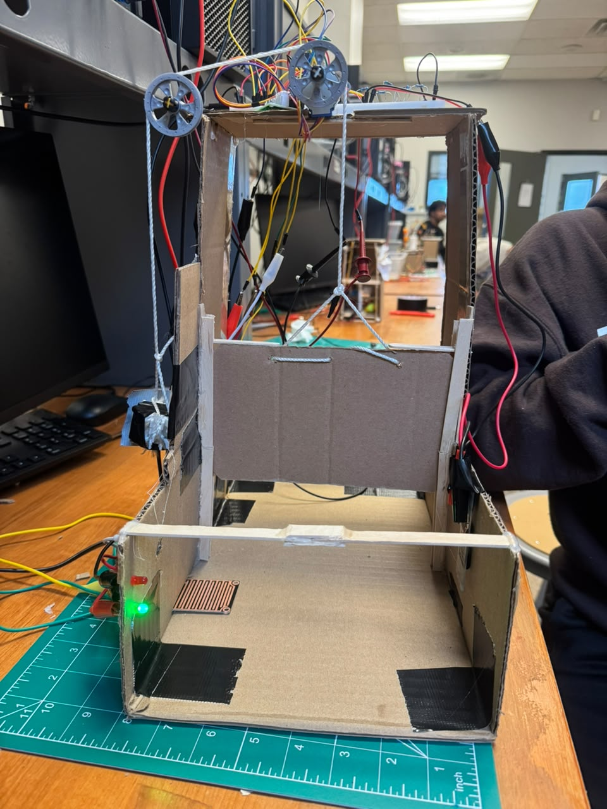
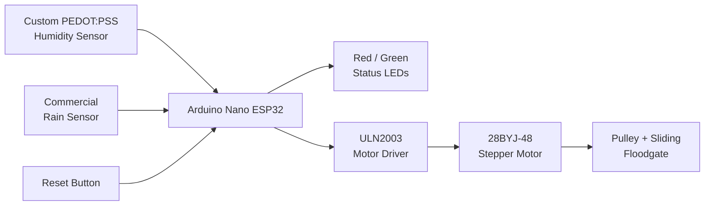
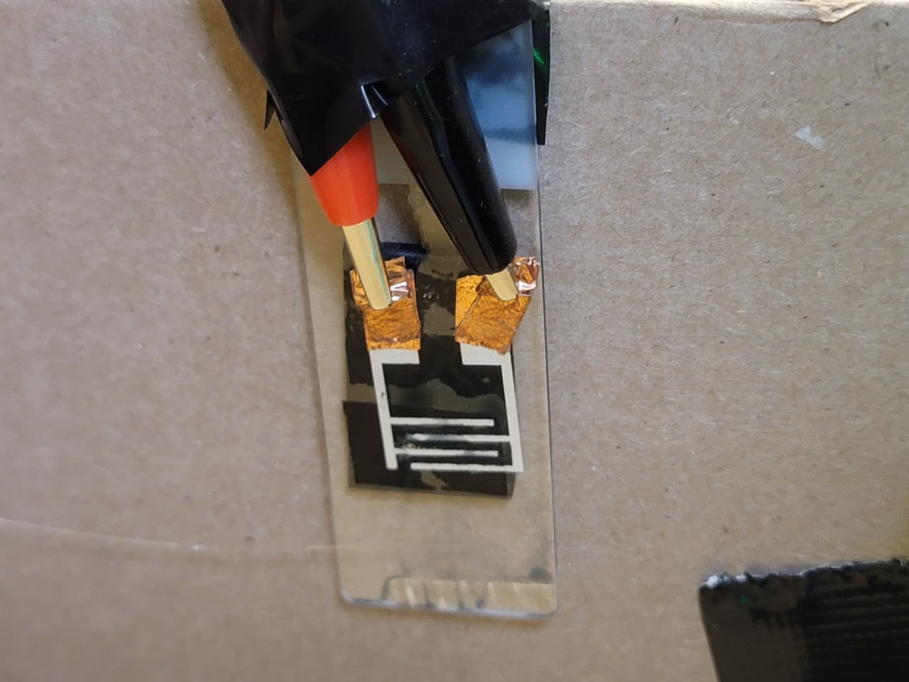
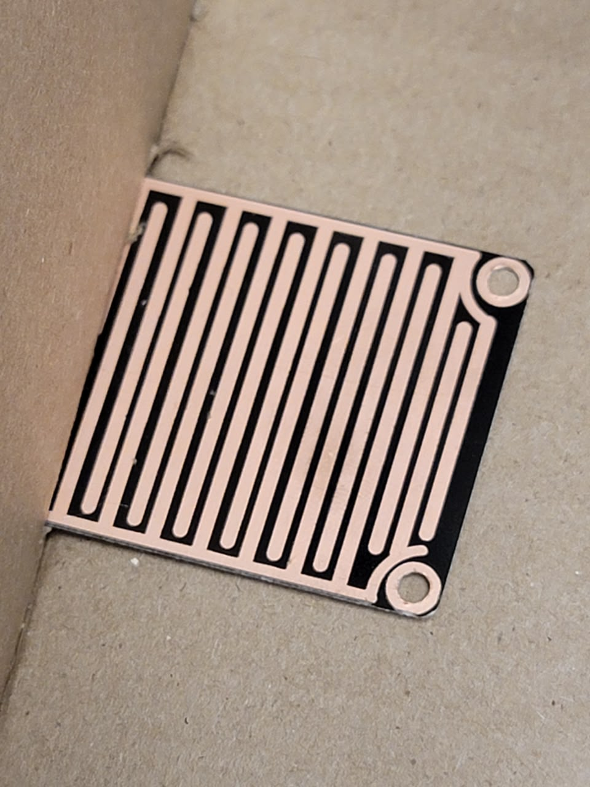
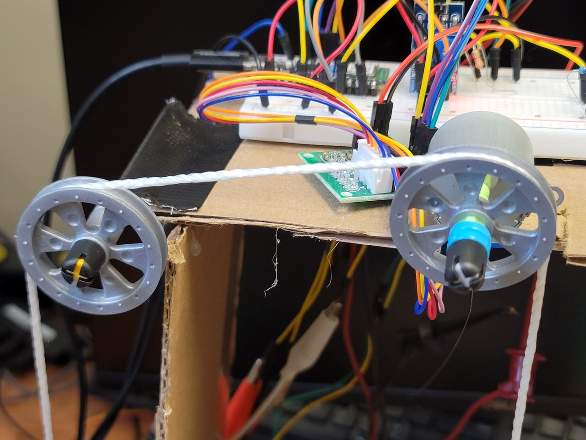
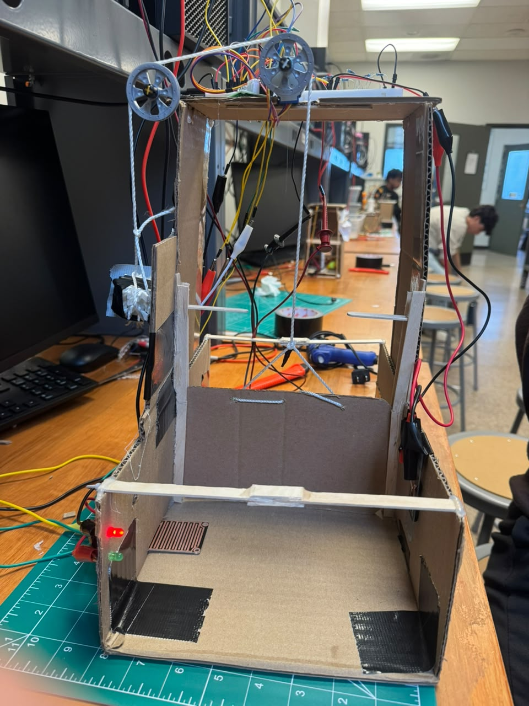
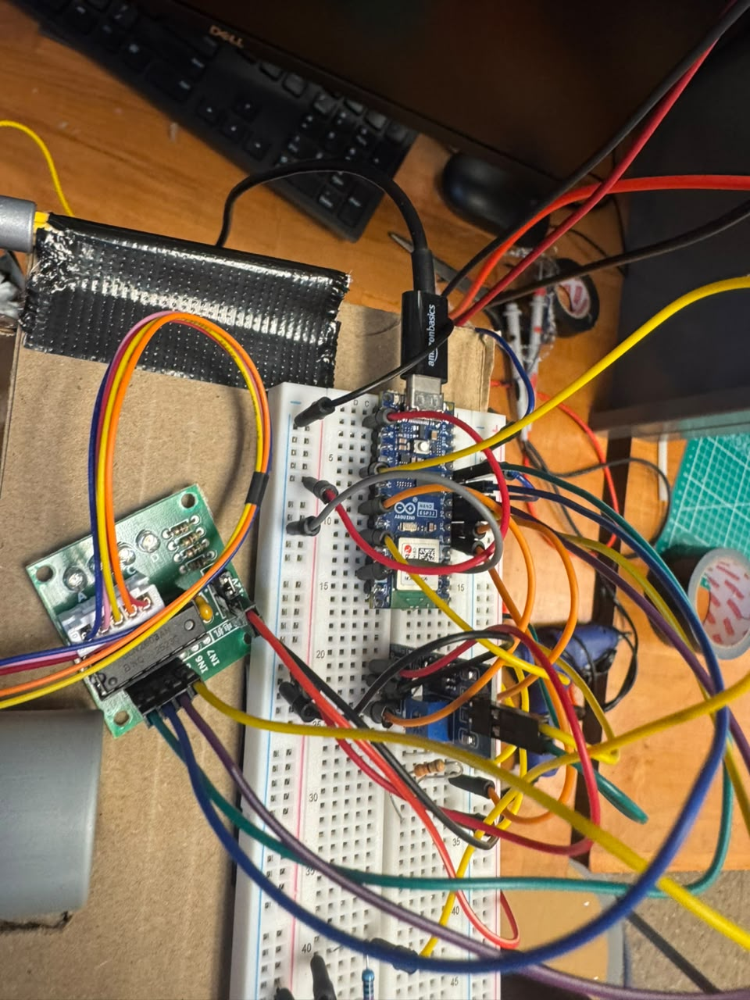
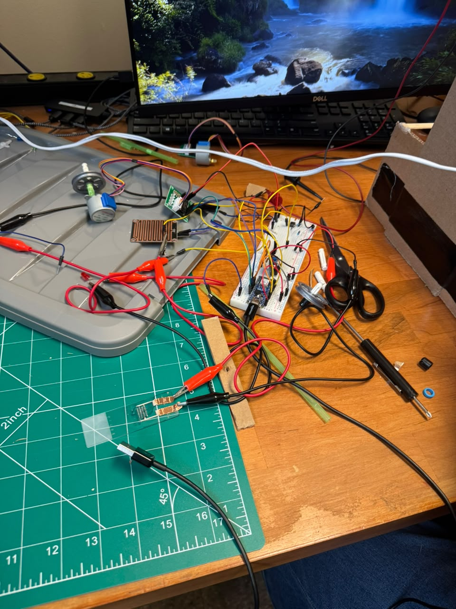
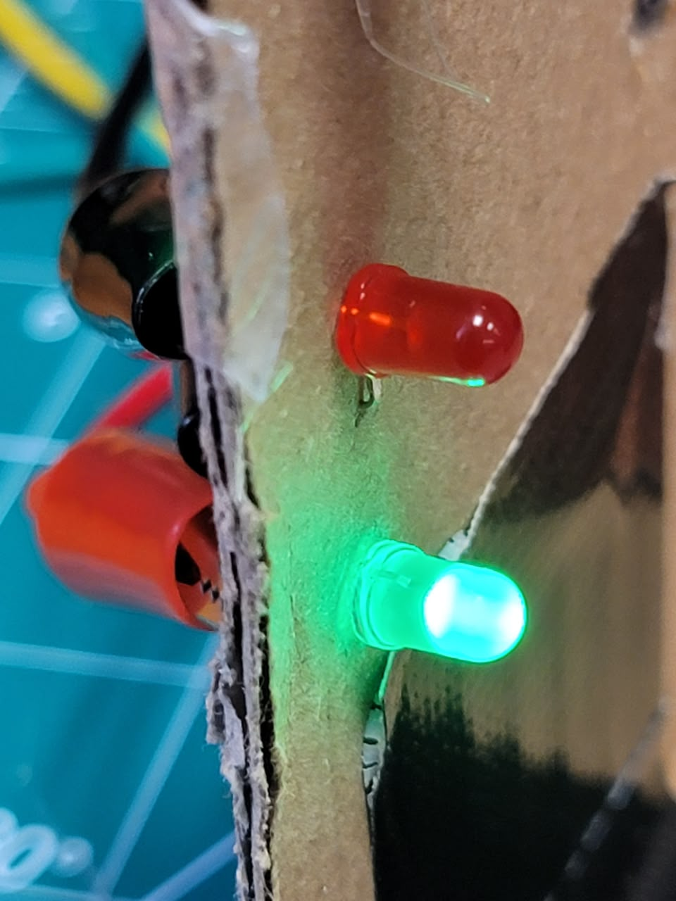

# Automatic Floodgate System

An ESP32-based flood-response system that detects unsafe moisture conditions and automatically deploys a sliding floodgate using a stepper motor.

The system combines a **custom PEDOT:PSS humidity sensor**, a **commercial rain sensor**, an **Arduino Nano ESP32**, a **28BYJ-48 stepper motor with ULN2003 driver**, status LEDs, and a manual reset input.



## Highlights

- Fabricated and calibrated a custom PEDOT:PSS humidity sensor for moisture detection.
- Combined humidity sensing and direct-water detection in one embedded control system.
- Implemented MicroPython control logic for automatic gate deployment, LED status indication, sensor recovery, and manual reset.
- Built a stepper-driven pulley system to raise and lower a sliding floodgate.
- Selected as **1 of 2 teams** to represent the Sensing the World module at Lehigh University's FYRE Expo, where the system was demonstrated to **400+ engineering students and VIP alumni**.

## System Overview

The system monitors two moisture inputs:

1. **PEDOT:PSS humidity sensor** — provides an early response to changes in ambient moisture.
2. **Commercial rain sensor** — detects direct water contact.

If either input reaches its trigger condition, the Arduino Nano ESP32 changes the system status to unsafe, switches the LEDs, and drives the stepper motor to close the floodgate.

After direct water is no longer detected, a pushbutton can reopen the gate. Because the PEDOT:PSS material can recover slowly after high humidity exposure, the software temporarily disarms that sensor after activation and automatically re-arms it once the reading returns close to its dry baseline.



## Hardware

| Component | Role |
|---|---|
| Arduino Nano ESP32 | Reads sensors and runs the control logic |
| Custom PEDOT:PSS sensor | Humidity / moisture-response input |
| Commercial rain sensor | Direct-water detection |
| 28BYJ-48 stepper motor | Mechanical gate actuation |
| ULN2003 driver | Interfaces the ESP32 with the stepper motor |
| Red LED | Unsafe condition / gate closed |
| Green LED | Safe condition / gate open |
| Pushbutton | Manual reset and reopening command |
| Sliding cardboard gate + string/pulley system | Physical flood barrier mechanism |

## Sensor Fabrication

The custom sensor uses **interdigitated silver-paint electrodes on glass with a PEDOT:PSS sensing layer**. Its electrical response changes with humidity, allowing the microcontroller to compare the live ADC reading against a dry startup baseline.



The commercial rain sensor provides a second input for direct water contact.



## Control Logic

At startup, the system calibrates the PEDOT:PSS sensor by averaging dry readings. During operation:

1. The rain sensor is checked against a direct-water threshold.
2. The PEDOT:PSS reading is compared with its dry baseline as a percentage change.
3. Multiple consecutive PEDOT:PSS readings are required before triggering to reduce false activations.
4. If either sensor triggers, the red LED turns on, the green LED turns off, and the stepper motor closes the gate.
5. The PEDOT:PSS sensor is temporarily disarmed while it recovers from humidity exposure.
6. When the rain sensor is dry, the reset button can reopen the gate.
7. The PEDOT:PSS sensor automatically re-arms after returning sufficiently close to its baseline.

The motor routine also includes a maximum run-time limit so the stepper outputs are forced off if movement continues longer than expected.

## Mechanical System

The floodgate slides vertically between guide rails. A string attached to the gate is routed through the pulley system and driven by a spool connected to the stepper motor.



### Gate open


### Gate closed



## Electronics

The control system integrates the Nano ESP32, sensors, LEDs, reset button, and ULN2003 motor driver on a breadboard-based circuit.



An earlier integration test was performed before the electronics were fully mounted into the gate structure.



## Software

The final MicroPython program is located at:

[`src/automatic_floodgate.py`](src/automatic_floodgate.py)

Selected component-level test programs are included in [`development/`](development/):

- [`01_stepper_motor_test.py`](development/01_stepper_motor_test.py)
- [`02_rain_sensor_test.py`](development/02_rain_sensor_test.py)
- [`03_pedot_sensor_response_test.py`](development/03_pedot_sensor_response_test.py)

## Testing

The system was tested under several operating conditions:

- Both sensors dry
- Direct water applied to the rain sensor
- Increased humidity applied to the PEDOT:PSS sensor
- Reset attempted while water was still detected
- Reset after direct-water conditions cleared
- Repeated gate opening and closing cycles
- Stepper movement in both directions
- LED status transitions between safe and unsafe states



## Team

This was a three-person engineering project completed by:

- **Diego Chuquillanqui**
- **Diane Ngo**
- **Artur Kis**

### My contributions

My work focused on **sensor characterization, MicroPython control logic, electronics integration, threshold detection, motor control, and system testing**.

## Recognition

The project was selected as **1 of 2 teams** from the module to represent Sensing the World at **Lehigh University's FYRE Expo**, where it was demonstrated to **400+ engineering students and VIP alumni**.

## Repository Structure

```text
automatic-floodgate-system/
├── README.md
├── .gitignore
├── src/
│   └── automatic_floodgate.py
├── development/
│   ├── 01_stepper_motor_test.py
│   ├── 02_rain_sensor_test.py
│   └── 03_pedot_sensor_response_test.py
└── images/
    ├── control-electronics.jpeg
    ├── electronics-and-sensor-test.jpeg
    ├── floodgate-system-closed.jpeg
    ├── floodgate-system-open.jpeg
    ├── pedot-pss-sensor.jpeg
    ├── rain-sensor.jpeg
    ├── status-leds.jpeg
    └── stepper-pulley-system.jpeg
```

## Context

Developed for **ENGR 095 — Sensing the World** at Lehigh University during Fall 2026. The course project focused on integrating a fabricated sensor into an embedded system addressing a real-world humanitarian concern.
